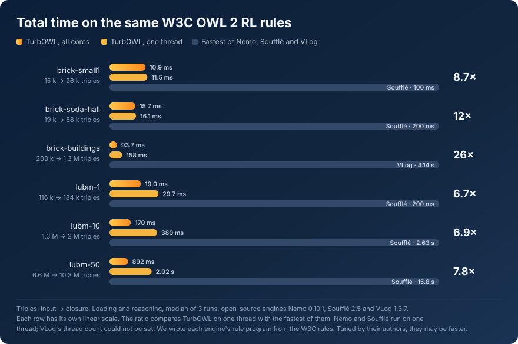

<p align="center">
  <picture>
    <source media="(prefers-color-scheme: dark)" srcset="assets/logo-wordmark-dark.svg">
    
  </picture>
</p>

<p align="center">
  
</p>

# TurbOWL

TurbOWL is an OWL 2 RL reasoner in Rust. It computes the closure that the
W3C OWL 2 RL rule tables define (OWL 2 Profiles §4.3, Tables 4 to 9) and
reports the contradictions and ill-typed literals they define. It is a
library with a small interface, a command line, and Python bindings that
take and return rdflib graphs. The core also builds for WebAssembly.

Independent oracles check every result: Nemo, OWL-RL, the W3C tests,
HermiT and a reference evaluator. No single reasoner is the judge.

TurbOWL is not on crates.io or PyPI yet.

## Performance

Total time, loading and reasoning, in the default configuration, median
of 3 runs. Every engine runs the same W3C OWL 2 RL rules, and every
closure is checked against TurbOWL's. The last column is how many times
as long the fastest open-source engine takes as TurbOWL on one thread.

| Scenario | Triples, input → closure | TurbOWL, one thread | TurbOWL, all cores | Fastest open-source engine | Ratio |
|---|---:|---:|---:|---|---:|
| brick-small1 | 14,817 → 26,381 | 11.5 ms | 10.9 ms | Soufflé, 100 ms | 8.7× |
| brick-soda-hall | 18,577 → 57,652 | 16.1 ms | 15.7 ms | Soufflé, 200 ms | 12× |
| brick-buildings | 203,066 → 1,255,681 | 158 ms | 93.7 ms | VLog, 4.14 s | 26× |
| lubm-1 | 116,017 → 184,086 | 29.7 ms | 19.0 ms | Soufflé, 200 ms | 6.7× |
| lubm-10 | 1,284,780 → 2,024,317 | 380 ms | 170 ms | Soufflé, 2.63 s | 6.9× |
| lubm-50 | 6,572,384 → 10,345,697 | 2.02 s | 892 ms | Soufflé, 15.8 s | 7.8× |

The engines it is measured against are the open-source Nemo 0.10.1,
Soufflé 2.5 and VLog 1.3.7. They are general rule engines: each runs any
Datalog program you give it, and we use Nemo as one of TurbOWL's oracles.
TurbOWL runs one fixed rule set and is built around it, which is where
most of the gap comes from. Every engine that finished gave the same
closure size as TurbOWL. RDFox, a commercial reasoner, could not be run
here, so it is not in these numbers.

We wrote each engine's rule program from the W3C rules. Tuned by their
authors, they may be faster. Corrections are welcome.

- With every rule on (the complete configuration, one run), the fastest
  open-source engine takes 10.6 to 28 times as long as TurbOWL on one
  thread.
- On lubm-50, the peak is 46.6 bytes per closure triple on one thread and
  53.0 on all cores. A saved snapshot of the reasoned state loads in
  0.10 s, against 0.92 s to parse and reason.
- After a change, TurbOWL reuses the previous closure: an added triple
  costs 0.2 ms and a removal 1.9 ms. None of the other engines updates a
  closure in place, so there is nothing to compare this with.

How the numbers were taken, including what favours the other engines:

- The other engines read a converted copy of the input, written once
  before any run: every literal and blank node becomes an IRI, as plain
  N-Triples or tab-separated text. TurbOWL parses the original Turtle, N3
  and RDF/XML files.
- Nemo has no thread option and Soufflé's build is single-threaded, so
  both ran on one thread. VLog's thread count could not be set through
  Rulewerk, which runs it. The all-cores column is TurbOWL's alone, and
  the ratios use TurbOWL's one-thread time.
- VLog's time is its own report, which leaves out the JVM's start, so
  every ratio against VLog favours VLog. Soufflé's program is compiled
  beforehand, untimed, and its time includes writing the closure.
- The machine was busy, at a 1-minute load average of 3 to 5. Each gap
  above is many times the spread between runs.
- A run that went past 16 GB was stopped. In the complete configuration
  VLog reached that cap on brick-buildings, lubm-1 and lubm-10.
- Loading is most of TurbOWL's total on lubm-50: 80% on one thread, 89% on
  all cores.

## Install

From a checkout, with Rust 1.99 or later:

```sh
cargo build --release --locked          # the library and the `turbowl` binary
./target/release/turbowl --help
```

Use the library as a path dependency:

```toml
[dependencies]
turbowl = { path = "path/to/turbowl/crates/turbowl" }
```

The `parallel` feature, on by default, brings the threads (rayon). Without
it, and always on WebAssembly, every round runs on the caller's thread.

The Python package needs Python 3.10 or later and `uv`. Maturin builds it
into `crates/python/.venv`:

```sh
cd crates/python && uv sync
uv run python -c "import turbowl; print(turbowl.__version__)"
```

## Use

### The command line

```sh
turbowl model.ttl -o closure.ttl                  # the closure, and a report on stdout
turbowl model.ttl --inferred-only                 # only the inferred triples, to stdout
turbowl model.ttl --summary-only --diagnostics json
turbowl --switch schema=on model.ttl              # one switch on
turbowl --complete model.ttl                      # every switch on: the W3C rule set
turbowl --switches                                # the switches, their defaults and costs
turbowl model.ttl --summary-only --save-snapshot state.snapshot
turbowl --load-snapshot state.snapshot more.ttl -o closure.ttl
RAYON_NUM_THREADS=1 turbowl model.ttl -o closure.ttl   # one thread
```

Each file's format comes from its extension (`.ttl`, `.nt`, `.n3`, `.rdf`,
`.owl`, `.xml`). The report is the diagnostics, then a summary, as text,
JSON or NDJSON. The exit status is 0 on success, 1 on an input or output
error, 2 on a diagnostic at or above `--fail-on` (default `error`), and 64
on a usage error. `turbowl --help` gives the details, and the JSON field
names are stable.

`--save-snapshot` saves the reasoner's state after the run, and
`--load-snapshot` starts from a saved state and adds the input files to
it. A loaded state keeps its switches, which `--complete` and `--switch`
then change. TurbOWL refuses a snapshot that is damaged, or of another
format or version, with exit status 1. The CLI uses every core;
`RAYON_NUM_THREADS=1` makes it use one.

### Rust

```rust
use turbowl::{Format, Reasoner, Switch, Switches};

let mut r = Reasoner::with_switches(Switches::default().on(Switch::Schema));
r.load_str(
    "@prefix ex: <http://example.org/> .
     @prefix rdfs: <http://www.w3.org/2000/01/rdf-schema#> .
     ex:Dog rdfs:subClassOf ex:Animal . ex:rex a ex:Dog .",
    Format::Turtle,
    None,
)?;
let summary = r.reason();
for triple in r.inferred() { /* ex:rex a ex:Animal, ... */ }
for d in r.diagnostics() { /* contradictions and ill-typed literals */ }
```

`Reasoner::new()` takes the default switches, and `Switches::complete()`
turns every switch on. `insert`, `remove` and `set_base` change the base
triples, and the next `reason()` reuses what it can.

```rust
use std::path::Path;
use turbowl::{Reasoner, Threads};

r.set_threads(Threads::ONE);                  // the default is Threads::ALL
r.save_snapshot(Path::new("state.snapshot"))?;
let mut again = Reasoner::from_snapshot(Path::new("state.snapshot"))?;
```

- **Loading.** TurbOWL's own parsers read N-Triples and Turtle and intern
  each term straight into its id. N3 and RDF/XML use Oxigraph's parsers.
  `load_file` reads N-Triples and Turtle in windows of 32 MiB, so a large
  file is never in memory whole. A document of 384 KiB or more is parsed
  in pieces on every core, with the same triples, term ids and errors as
  a sequential parse.
- **Threads.** A run uses every core by default (`Threads::ALL`). A round
  of 65,536 tuples or more runs its rule families as parallel tasks;
  smaller rounds, such as those after an editor's change, stay on the
  caller's thread. `Threads::ONE` runs on one thread. The closure, the
  diagnostics and the order of every read are the same at any thread
  count.
- **Snapshots.** `save_snapshot` writes the reasoner's whole state to a
  file, atomically. `from_snapshot` gives it back: the same closure,
  diagnostics and switches, and the same next run. `write_snapshot` and
  `from_snapshot_bytes` do the same with bytes, for WebAssembly. The format
  is versioned and checksummed; a damaged file, or one of another version,
  is refused with `Error::Snapshot`.
- **Counters.** `Reasoner::profile` reports what the last run did, round
  by round and step by step, and the bytes the reasoner holds, by part. It
  is meant for benchmarks, and its fields may change.

### Python

```python
from rdflib import Graph, Namespace, RDF, RDFS
import turbowl

EX = Namespace("http://example.org/")
g = Graph()
g.add((EX.Dog, RDFS.subClassOf, EX.Animal))
g.add((EX.rex, RDF.type, EX.Dog))

r = turbowl.Reasoner(switches={"schema": True})   # or turbowl.Reasoner(complete=True)
r.insert(g)
summary = r.reason()
assert (EX.rex, RDF.type, EX.Animal) in r.inferred()
closure = r.graph()                               # an rdflib Graph

r.save_snapshot("state.snapshot")
again = turbowl.Reasoner.from_snapshot("state.snapshot")
```

A refused snapshot raises `turbowl.SnapshotError`. Parsing, reasoning,
writing and snapshots release the GIL. `help(turbowl)` documents the
package.

### Explanations

TurbOWL can say why a triple is in the closure, or why it reported a
diagnostic: a proof from base triples, one W3C rule per step.

```sh
turbowl model.ttl --explain '<http://example.org/a> <http://example.org/p> <http://example.org/c>'
```

```text
<http://example.org/a> <http://example.org/p> <http://example.org/c>  [eq-rep-s]
  <http://example.org/b> owl:sameAs <http://example.org/a>  [eq-sym]
    <http://example.org/a> owl:sameAs <http://example.org/b>  [base]
  <http://example.org/b> <http://example.org/p> <http://example.org/c>  [base]
```

```rust
let proof = r.explain(triple.as_ref())?;        // Ok(None): not in the closure
let explainer = r.explainer()?;                 // one explainer for many questions
```

```python
proof = r.explain(EX.rex, RDF.type, EX.Animal)  # None when not in the closure
print(proof)                                    # the tree above
proof.leaves()                                  # the base triples it rests on
```

- Reasoning records nothing for explanations. The explainer computes a
  proof when you ask, by running the rule program backwards over the
  closure, and keeps a shallowest one. Reasoning's time and memory do not
  change.
- It works in every configuration, `owl:sameAs` and literal values
  included, and writes the proof in your terms, not the representatives
  the store keeps.
- The reference evaluator replays every proof the tests produce, on every
  minimal input of the oracle suite and every chaos input.
- `--explain-diagnostics` adds each diagnostic's proof, and the JSON and
  NDJSON reports carry proofs as objects. Asking after a change without
  reasoning again is `Error::NotReasoned` in Rust and
  `turbowl.NotReasonedError` in Python.
- It gives one shallow proof per question. It does not list all proofs,
  minimal sets of axioms (justifications), or answer "why not?".

### Cancellation

Another thread can stop a run or a proof search. An editor, for example,
cancels the run for one keystroke when the next one comes.

```rust
let cancel = turbowl::Cancel::new();            // give a clone to the other thread
match r.reason_cancellable(&cancel) {
    Err(turbowl::Error::Cancelled) => {}        // no partial result
    done => { done?; }
}
```

```python
cancel = turbowl.Cancel()                       # cancel.cancel() from any thread
r.reason(cancel=cancel)                         # raises turbowl.CancelledError
```

- A run checks the handle before each round, and a search between its
  steps. In Python, Ctrl+C stops both and raises `KeyboardInterrupt`.
- A cancelled run keeps no partial result, and the next run is a full
  one. A cancelled search keeps the explainer's indexes.
- `reason()` is unchanged: it runs the same path without a handle.

## The rules and the switches

Every rule belongs to the always-on core or to exactly one switch, a named
group of rules. A switch is off by default when other reasoners rarely
implement its rules, or when it slows reasoning by more than 5% on a
benchmark scenario. The complete configuration, every switch on, is the
W3C rule set.

| Switch | Rules | Default | Why |
|---|---|---|---|
| none (the core) | cax-sco, cax-eqc1/2, cls-thing, cls-nothing1, cls-int1/2, cls-uni, cls-svf1/2, cls-avf, cls-hv1/2, cls-oo, prp-dom, prp-rng, prp-fp, prp-ifp, prp-symp, prp-trp, prp-spo1, prp-eqp1/2, prp-inv1/2, scm-sco, scm-eqc1 | always on | |
| `equality` | eq-sym, eq-trans, eq-rep-s/p/o | on | As in other OWL 2 RL reasoners |
| `property-chains` | prp-spo2 | on | As in other OWL 2 RL reasoners |
| `checks` | cax-dw, cax-adc, cls-com, cls-nothing2, cls-maxc1, cls-maxqc1/2, prp-irp, prp-asyp, prp-pdw, prp-adp, prp-npa1/2, eq-diff1/2/3, dt-not-type | on | Contradictions and ill-typed literals are reported |
| `identity` | prp-key, cls-maxc2, cls-maxqc3/4 | off | 26% slower on uobm-010-u, where it grows the closure from 21.3 M to 39.1 M triples, and 6% slower on claros-l |
| `schema` | scm-eqc2, scm-spo, scm-eqp1/2, scm-dom1/2, scm-rng1/2, scm-hv, scm-svf1/2, scm-avf1/2, scm-int, scm-uni | off | 22% to 39% slower on the editor-size scenarios and up to 62% on the larger ones; 35% slower on LUBM, where it adds 99 triples |
| `trivial` | eq-ref, scm-cls, scm-op, scm-dp, prp-ap, dt-type1, dt-type2 | off | Rarely implemented elsewhere, and filler: `x owl:sameAs x` for every term, four triples per class, each literal's datatypes |
| `literal-values` | dt-eq, dt-diff | off | Rarely implemented elsewhere; it reads every literal's value. dt-diff only checks: it adds no `owl:differentFrom` triples |

owlrl, GraphDB and the OWL-RS Nemo program implement the `identity` and
`schema` rules, so the defaults give less than they do: no key merges and
no schema subsumptions. Each group comes back with one switch.

dt-not-type and the value rules use the 32 datatypes OWL 2 RL supports
(OWL 2 Profiles §4.2.1). TurbOWL handles `owl:sameAs` with
representatives: equal terms share one id inside, and reading the closure
expands them. A clique of 1,000 aliases, 11,000,002 triples once expanded,
reasons in 0.333 ms and stores 10,003 tuples.

## Verification

TurbOWL compares each closure, as a set, with several oracles, each
judging something different:

- **Nemo** runs the W3C forms of the same rules, one file per switch group
  (`oracles/rules/`). Closures and findings must be equal.
- **OWL-RL** (owlrl on rdflib) must contain the closure, apart from the
  differences listed below.
- **The W3C tests**: the OWL 2 RL test cases and the RDF 1.1 Semantics
  entailment tests.
- **HermiT** must entail every inferred subsumption it can judge.
- **A reference evaluator**, a simple and slow evaluator of the same rules,
  judges chaos runs: inputs and configurations generated from a seed. Each
  chaos run also reasons on one thread and on all cores, and the two must
  give the same summary, closure in read order, and diagnostics.

Results in the default and the complete configuration:

| Judge | Result |
|---|---|
| Every suite: the library, the CLI, the oracle files, the reference evaluator, the benchmark, pytest (787) | Passed |
| W3C OWL 2 RL (complete configuration) | 101 of 119 runnable cases, every case Nemo passes (Nemo 101, OWL-RL 100) |
| W3C RDF-MT (complete configuration) | 35 of 51 runnable cases (Nemo 28, OWL-RL 30) |
| Brick with small1 and its three variants, and with soda hall | Equal to Nemo, closures and findings |
| 108 building models | Equal to Nemo, closures and findings |
| 100,000 full chaos runs | 99,152 compared, all equal; 848 too large for the reference evaluator |
| 100,000 incremental chaos runs | 99,176 compared, all equal; 824 too large for the reference evaluator |

A cross-check holds TurbOWL's own parsers to Oxigraph's: 16,235 parses of
221 files and 5,193 strings, and 120,000 generated documents, give the
same triples, term ids and errors. The same check compares the parse in
pieces with the sequential one. A snapshot's round trip gives the same
closure, diagnostics and switches on the minimal inputs and on Brick, and
TurbOWL refuses every changed byte or truncation of a small snapshot.

The 18 W3C OWL 2 RL cases that fail, fail on Nemo and OWL-RL too. Fifteen
expect a conclusion no OWL 2 RL rule derives: 8 hold by refutation (a
difference or a complement type that no rule concludes), 3 need reasoning
about datatypes, 1 needs a new term, and 3 need a rule the tables do not
have. The other 3 depend on how the test runner reads a case: an import,
and annotations under the Direct Semantics.

### Where OWL-RL differs from the W3C text

OWL-RL is a widely used reasoner and one of TurbOWL's oracles. Where it
departs from the W3C rules or the datatype definitions they rest on, we
record the difference against the W3C text, with a test, and filter it
only where OWL-RL misses something. These are differences of owlrl 7.6.2
on rdflib 7.6.0; Nemo, HermiT and the W3C tests have none. The source
lines and the W3C text for each are in `crates/oracle/src/differences.rs`.

| Id | What OWL-RL does |
|---|---|
| F1 | Its scm-sco and scm-spo never derive `c rdfs:subClassOf c` or `p rdfs:subPropertyOf p`, so scm-eqc2 and scm-eqp2 miss `c owl:equivalentClass c` and `p owl:equivalentProperty p` |
| F2 | Its cls-com finding names the second class where the individual belongs |
| F3 | Its dt-not-type accepts a lexical form with leading or trailing whitespace |
| F4 | It fails on a cyclic list |
| F5 | Its dt-not-type checks a literal only against its own datatype, never a type from prp-rng |
| F6 | Its eq-diff2, eq-diff3 and prp-adp miss positions of a list |
| F7 | Its dt-not-type reads numbers with Python's `int()` and `Decimal()` |
| F8 | Its dt-not-type rejects zeros, INF, NaN and rounded numerals of `xsd:double` and `xsd:float` |
| F9 | Its dt-not-type has different lexical spaces for booleans, binaries, the XML name types, `xsd:normalizedString` and `xsd:anyURI` |
| F10 | Its dt-not-type reads `xsd:dateTime` with `time.strptime` |
| F11 | Its dt-not-type parses an `rdf:XMLLiteral` as a whole document |
| F12 | rdflib rewrites the lexical forms of `xsd:token` and `xsd:normalizedString` literals |
| F13 | Its prp-key never compares a key's last property |
| F14 | Its cardinality rules compare Python values, so a double, float or boolean cardinality fires them |
| F15 | It skips dt-eq and dt-diff, and its dt-type2 types a literal with its own datatype and that datatype's supertypes only |

F8, F11, F13 and F14, and parts of F9 and F10, only derive or report more
than the W3C rules. Containment never sees those, so they filter nothing.

## Working on it

`AGENTS.md` says how to build, test and verify. `CONTEXT.md` defines the
words the project uses, and `docs/adr/` records why it is built this way.
Every full verification is in `docs/verification/`, with its raw results.

## License

MIT. See `LICENSE`.
